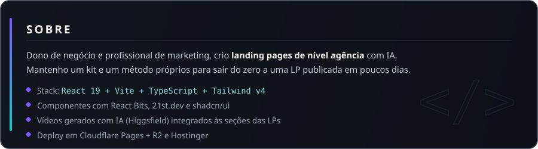

## 🧩 Como eu trabalho

Landing pages pensadas como projeto de agência, construídas e publicadas com apoio de IA do zero ao ar:

| Etapa | O que entra |
|---|---|
| 🎨 UI | Componentes prontos de React Bits, 21st.dev e shadcn/ui, usados como base e ajustados ao projeto |
| 🎬 Mídia | Vídeos e imagens gerados com IA no Higgsfield, sem compressão, direto nas seções |
| ⚙️ Base | React 19 + Vite + TypeScript + Tailwind v4 |
| ☁️ Deploy | Cloudflare Pages + R2 para mídia pesada, e Hostinger quando o projeto pede |
| 📐 Método | Kit e processo próprios para repetir o padrão de qualidade em cada LP nova |

> Os projetos e repositórios dos clientes ficam em repos privados e não aparecem aqui.

## 📈 Métricas

<picture>
  <source media="(prefers-color-scheme: dark)" srcset="https://raw.githubusercontent.com/kayky05/kayky05/output/github-snake.svg" />
  <source media="(prefers-color-scheme: light)" srcset="https://raw.githubusercontent.com/kayky05/kayky05/output/github-snake-light.svg" />
  
</picture>

 

 

## 🛠️ Stack

